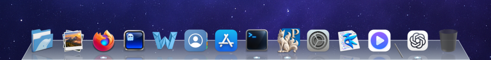
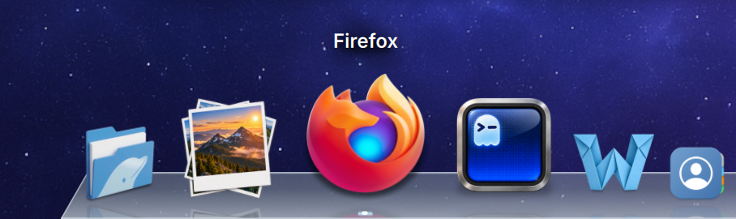
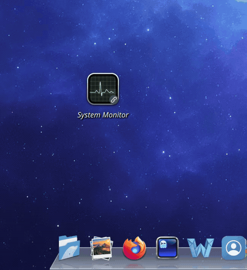
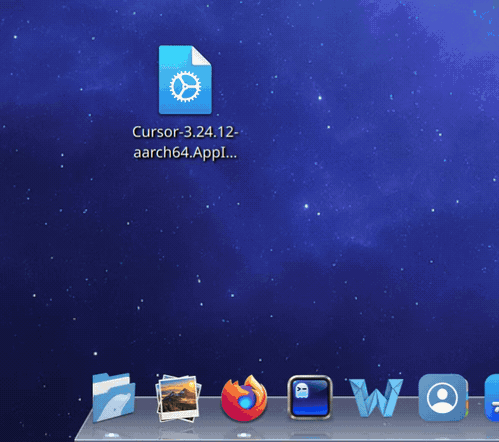

# spacedock


Spacedock is an application built on Qt for KDE's Plasma desktop environment. It is designed as a replacement for Plasma's conventional panel and application launchers and is inspired by classic Mac OS X. It uses no proprietary code.

### Notice

**This is an AI developed project.** Care has been put into its design, functionality, security, and performance—but this is a product of primarily AI code. Use at your own discretion.

This tool is in beta and **will** have bugs! Please report them.





## Current version Beta 0.5.1 - November 1, 2026

* Initial GitHub upload

### Features

* A Mac OS X inspired dock with toggleable and tweakable magnification and size
* Toggleable auto-hide with smooth animations
* Drag and drop shortcuts
* Trashcan built into the dock
* Real-time dock scaling
* Icon label and image customization
* AppImage handling/workaround

### Features in development

* Folder view/fanning folder view
* Application launcher
* Themes, including flat design
* Better DPI scaling (developed on 1.5x scale; other variations need testing)
* Drag dock separator to scroll
* Better right-click menu design
* Better support for older versions of Plasma and Qt

### Known bugs and limitations

* Some unnecessary image/icon calls during dock scaling
* Some animations have some jank, such as AppImage shuffling when assigning apps
* Fullscreen windows can cover the auto-hide reveal strip
* You tell me! Submit bugs and I can work on fixing them

## Build

SpaceDock requires Plasma 6 on Wayland, Qt 6.6 or newer, KDE Frameworks 6, CMake 3.22 or newer, and a C++20 compiler.

### Debian 13

From a Plasma Wayland desktop session, run:

```sh
./tools/install-debian.sh
```

The script installs dependencies, builds SpaceDock, and installs it under `~/.local`. Run it as your normal user; it asks for `sudo` when installing packages. The desktop has been tried on Debian 13, but the installer has not yet been verified on a fresh installation.

Start SpaceDock from the application menu or run `spacedock` in a Plasma Wayland session. The command is installed at `~/.local/bin/spacedock`; see [Command-line access](#command-line-access) if your shell cannot find it.

### Fedora

```sh
sudo dnf install gcc-c++ cmake make python3 qt6-qtbase-devel qt6-qtdeclarative-devel kf6-kconfig-devel kf6-kcoreaddons-devel kf6-kservice-devel kf6-kwidgetsaddons-devel plasma-workspace layer-shell-qt
cmake -S . -B build -DCMAKE_BUILD_TYPE=Release
cmake --build build --parallel 2
./tools/run-dev.sh
```

Run the last command in a Plasma Wayland desktop session. The development runner registers the desktop entry before starting the dock. To run the tests, use `ctest --test-dir build --output-on-failure`.

To install the built application for your user and make it available from the application menu, run:

```sh
cmake --install build --prefix "$HOME/.local"
```

You can then run `spacedock` in a Plasma Wayland session. See below if your shell cannot find the command.

### Arch Linux and Arch-based distributions

Install the dependencies, then build and install SpaceDock for your user:

```sh
sudo pacman -Syu --needed base-devel cmake python \
  qt6-base qt6-declarative qt6-wayland \
  kconfig kcoreaddons kservice kwidgetsaddons \
  plasma-workspace layer-shell-qt
cmake -S . -B build -DCMAKE_BUILD_TYPE=Release
cmake --build build --parallel 2
cmake --install build --prefix "$HOME/.local"
```

Start SpaceDock from the application menu or run `~/.local/bin/spacedock` in a terminal on the Plasma Wayland desktop. An ordinary SSH shell does not have the graphical session environment needed to start the dock. You can check the desktop session type with `echo "$XDG_SESSION_TYPE"`; it should print `wayland`.

### Command-line access

The user install places the executable in `~/.local/bin`. If `command -v spacedock` finds nothing, add that directory to your shell's `PATH`. For Bash, add this line to `~/.bashrc`; for Zsh, add it to `~/.zshrc`:

```sh
export PATH="$HOME/.local/bin:$PATH"
```

Open a new terminal for the change to take effect. You can also run `~/.local/bin/spacedock` directly.

## See it in action

### Hover animation


### Add and remove shortcuts



### Rearrange launchers


### AppImage handling



## Licensing & Notices

SpaceDock's source code and documentation are available under the [MIT License](LICENSE). You may use, modify, and distribute them, including commercially, while retaining the copyright and license notice. Assets are listed separately in [assets/MANIFEST.csv](assets/MANIFEST.csv); their distribution terms have not yet been finalized. Third-party dependencies have their own licenses.

Firefox and the Firefox logo are trademarks of the Mozilla Foundation in the U.S. and other countries. Other application names and logos belong to their respective owners. SpaceDock is an independent project and is not affiliated with or endorsed by those owners.
